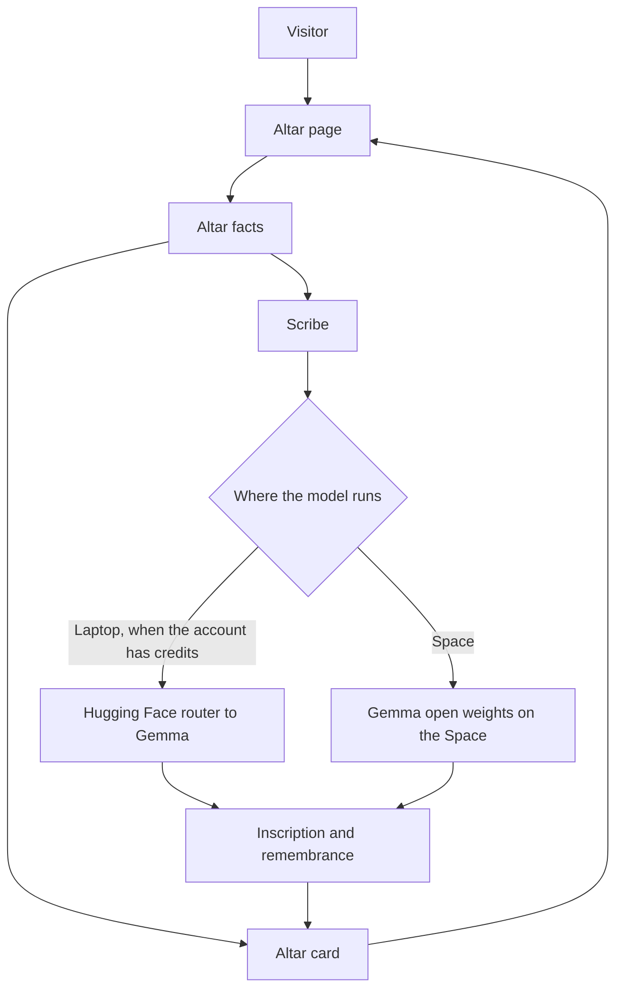

# Lumbre

Lumbre letters a Día de los Muertos altar card. You write a name, a memory, and only the foods, songs, and objects you actually know. An open-weight Gemma model writes the lines on the card. Anything you leave blank stays blank.

The memory you typed is kept word for word. The offering list is built in code from those fields, so the model cannot add a favorite food you never named.

## Why open weights

Gemma's weights are public. Lumbre is not tied to one closed chat API. The same scribe can call a larger Gemma through the Hugging Face router, or load a small Gemma on a Hugging Face Space, by changing a model id. The laptop does not download the weights. On the Space they stay on Hugging Face's machines. A note is sent only for that one reply, and Lumbre does not store it.

## Architecture



The facts also go straight onto the card: the name, the years, the memory as told, and the offerings. The model only writes the inscription and the remembrance.

## Run it on a laptop

The page is small. The model is not installed here.

```powershell
python -m venv .venv
.\.venv\Scripts\Activate.ps1
pip install streamlit python-dotenv requests
copy .env.example .env
streamlit run app.py
```

Put your Hugging Face token in `.env` as `HF_TOKEN`. That file is gitignored. `.env.example` only shows the names.

```
HF_TOKEN=hf_your_token_here
HF_MODEL=google/gemma-3-4b-it:cheapest
```

The router call needs Inference Providers credits on the Hugging Face account. Without credits, the public demo is the Space, which loads the weights itself.

## Hosted demo

The Space is a container on Hugging Face. It runs this page and loads `google/gemma-3-270m-it` there, so the weights stay off your laptop. If that model cannot be loaded, it falls back to `HuggingFaceTB/SmolLM2-360M-Instruct`, and the card names whichever model answered.

https://huggingface.co/spaces/Ashraf01k/lumbre

Publish an update with `HF_TOKEN` in `.env` and:

```powershell
pip install huggingface_hub
python scripts/publish_space.py
```

The script refuses to upload if a token-like string is in the source files. It never uploads `.env`.

## Layout

```text
app.py                 altar page
lumbre/altar.py        facts, offerings, and gaps
lumbre/prompts.py      instructions for the model
lumbre/scribe.py       turns a reply into a card
lumbre/inference.py    router call, or weights on the Space
lumbre/render.py       card layout
tests/                 offerings, parsing, and token checks
```

## Secrets

Keep `HF_TOKEN` in `.env` or in Streamlit secrets. Do not put it in source, the README, or a commit. If a token was pasted into a chat or a screenshot, revoke it on Hugging Face and create a new one.
