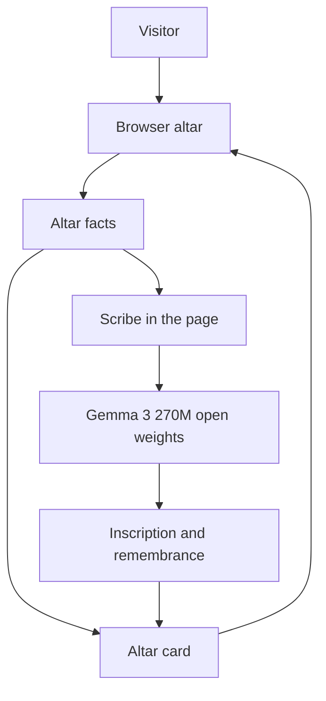

# Lumbre

Lumbre letters a Día de los Muertos altar card. You write a name, a memory, and only the foods, songs, and objects you actually know. An open-weight Gemma model writes the lines on the card. Anything you leave blank stays blank.

The memory you typed is kept word for word. The offering list is built in code from those fields, so the model cannot add a favorite food you never named.

## Why open weights

Gemma's weights are public. The altar downloads a small Gemma into the browser and writes the card there, so the memory is not sent to a chat API. The Python page can call a larger Gemma through the Hugging Face router when that account has credits, by changing the model id. A closed model would send the memory to a vendor's server and lock the wording to that vendor.

## Architecture



The facts also go straight onto the card: the name, the years, the memory as told, and the offerings. The model only writes the inscription and the remembrance. The weights download into the browser from Hugging Face. The note is not uploaded.

## Run it on a laptop

The page is small. The model is not installed here.

```powershell
python -m venv .venv
.\.venv\Scripts\Activate.ps1
pip install streamlit python-dotenv requests
copy .env.example .env
streamlit run app.py
```

Put your Hugging Face token in `.env` as `HF_TOKEN`. That file is gitignored. `.env.example` only shows the names.

```
HF_TOKEN=hf_your_token_here
HF_MODEL=google/gemma-3-4b-it:cheapest
```

The router call needs Inference Providers credits on the Hugging Face account. Without credits, open `web/index.html` or the public Space. That page runs Gemma in the browser.

## Hosted demo

The public altar is a static page. The first card downloads Gemma 3 270M (`onnx-community/gemma-3-270m-it-ONNX`, q4f16) into the visitor's browser and letters the card there. A Docker Space was not used, because free accounts cannot host one. The router path above is for an account that has Inference Providers credits.

https://huggingface.co/spaces/Ashraf01k/lumbre

Publish an update with `HF_TOKEN` in `.env` and:

```powershell
pip install huggingface_hub
python scripts/publish_space.py
```

The script refuses to upload if a token-like string is in the source files. It never uploads `.env`.

## Layout

```text
web/                   public altar, Gemma in the browser
app.py                 same altar through the Hugging Face router
lumbre/altar.py        facts, offerings, and gaps
lumbre/prompts.py      instructions for the model
lumbre/scribe.py       turns a reply into a card
lumbre/inference.py    router call, or weights when a Space can load them
lumbre/render.py       card layout
tests/                 offerings, parsing, and token checks
```

## Secrets

Keep `HF_TOKEN` in `.env` or in Streamlit secrets. Do not put it in source, the README, or a commit. If a token was pasted into a chat or a screenshot, revoke it on Hugging Face and create a new one.
