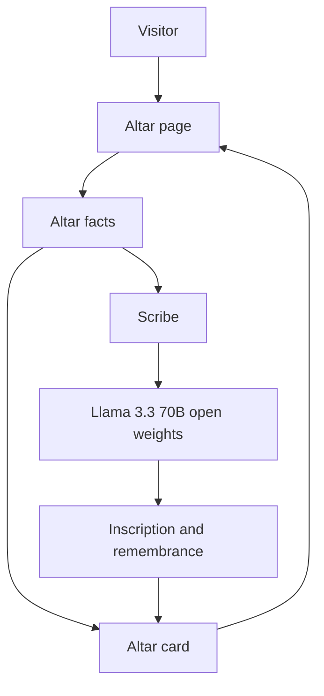

# Lumbre

Lumbre letters a Día de los Muertos altar card. You write a name, a memory, and only the foods, songs, and objects you actually know. Llama 3.3 70B, an open-weight model, writes the lines on the card. Anything you leave blank stays blank.

The memory you typed is kept word for word. The offering list is built in code from those fields, so the model cannot add a favorite food you never named.

## Why open weights

Llama 3.3's weights are public. The altar calls that model on a host, so a card comes back in a few seconds and the page does not download hundreds of megabytes. The model id is one constant, so it can be swapped for another open instruct model. A closed API would lock the wording to one vendor.

## Architecture



The facts also go straight onto the card: the name, the years, the memory as told, and the offerings. The model only writes the inscription and the remembrance. The note is sent once for that reply.

## Run it on a laptop

The page is small. The model is not installed here.

```powershell
python -m venv .venv
.\.venv\Scripts\Activate.ps1
pip install streamlit python-dotenv requests
copy .env.example .env
streamlit run app.py
```

Put your Hugging Face token in `.env` as `HF_TOKEN`. That file is gitignored. `.env.example` only shows the names.

```
HF_TOKEN=hf_your_token_here
HF_MODEL=google/gemma-3-4b-it:cheapest
```

By default the page calls the hosted Llama model, with no token and no download. Set `LUMBRE_BACKEND=router` only if the Hugging Face account has Inference Providers credits.

## Hosted demo

The public altar calls Llama 3.3 70B Instruct. A card takes a few seconds. The browser does not download the weights.

https://ashraf01k-lumbre.static.hf.space

The Space page is https://huggingface.co/spaces/Ashraf01k/lumbre.

Publish an update with `HF_TOKEN` in `.env` and:

```powershell
pip install huggingface_hub
python scripts/publish_space.py
```

The script refuses to upload if a token-like string is in the source files. It never uploads `.env`.

## Layout

```text
web/                   public altar
app.py                 same altar through the Hugging Face router
lumbre/altar.py        facts, offerings, and gaps
lumbre/prompts.py      instructions for the model
lumbre/scribe.py       turns a reply into a card
lumbre/inference.py    router call, or weights when a Space can load them
lumbre/render.py       card layout
tests/                 offerings, parsing, and token checks
```

## Secrets

Keep `HF_TOKEN` in `.env` or in Streamlit secrets. Do not put it in source, the README, or a commit. If a token was pasted into a chat or a screenshot, revoke it on Hugging Face and create a new one.
